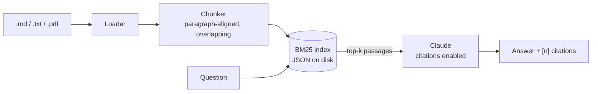

# DocQA

[](https://github.com/NarasimhaPasumarthy/docqa/actions/workflows/ci.yml)


**Ask questions about your company's documents. Get short answers that cite the exact passages they came from.**

New hires and support teams spend hours searching handbooks, policies and wikis. DocQA indexes
those documents and answers questions in plain language, and every claim links back to a quoted
source passage so the answer can be checked. When the documents don't cover a question, DocQA says
so instead of making something up.

Example:

```text
Q: How many vacation days can I carry over?

A: You can carry over up to 5 unused vacation days into the next year [1]. They must be used
   by March 31, after which they expire [2].

[1] employee-handbook.md: "You can carry over up to 5 unused vacation days into the next year."
[2] employee-handbook.md: "Carried-over days must be used by March 31, after which they expire."
```

## Features

- **Grounded answers with citations.** Retrieved passages go to Claude as citable documents, using the
  API's native [citations](https://platform.claude.com/docs/en/build-with-claude/citations). Quotes are
  extracted by the API rather than generated, so they can't be fabricated.
- **Abstains when it should.** The eval set includes questions the documents can't answer, to check that
  the model declines instead of guessing.
- **Measured retrieval quality.** A labelled question set reports hit rate and MRR. CI fails if
  retrieval quality drops.
- **Upload your own files.** Markdown, text and PDF, through the web UI, the REST API or the CLI.
  Re-uploading a file replaces its previous version.
- **Production basics.** Typed FastAPI endpoints with OpenAPI docs at `/docs`, input validation, upload
  size limits, clear errors for API failures, an atomic on-disk index, a Docker image running as a
  non-root user with a healthcheck, and CI on two Python versions.

## Architecture



| Module | Responsibility |
|---|---|
| [`docqa/chunking.py`](docqa/chunking.py) | Packs paragraphs into chunks of at most 1,200 characters. A short heading is repeated at the start of the next chunk so it keeps its context. |
| [`docqa/retriever.py`](docqa/retriever.py) | Pure-Python BM25 with idempotent per-file upserts and atomic saves. |
| [`docqa/llm.py`](docqa/llm.py) | Builds the Claude request and turns citation blocks into numbered `[n]` markers. |
| [`docqa/api.py`](docqa/api.py) | FastAPI app: `/ask`, `/documents`, `/health` and the web UI. |
| [`docqa/evaluate.py`](docqa/evaluate.py) | Retrieval metrics (offline) and answer grading (live). |

## Project structure

```text
docqa/
├── docqa/                    # Application package
│   ├── __init__.py           # Package version
│   ├── api.py                # FastAPI app: /ask, /documents, /health, web UI
│   ├── chunking.py           # Paragraph-aligned chunking with overlap
│   ├── cli.py                # `docqa` command: ingest | ask | eval | serve
│   ├── config.py             # Settings from environment variables
│   ├── evaluate.py           # Retrieval metrics and answer grading
│   ├── ingest.py             # Load → chunk → index pipeline
│   ├── llm.py                # Claude request with citations, response parsing
│   ├── loaders.py            # Text extraction for .md, .txt and .pdf
│   ├── retriever.py          # BM25 index with JSON persistence
│   └── static/
│       └── index.html        # Single-page web UI
├── tests/                    # Offline test suite (fake Claude client)
│   ├── test_api.py
│   ├── test_chunking.py
│   ├── test_evaluate.py      # Retrieval quality gate
│   ├── test_llm.py
│   └── test_retriever.py
├── eval/
│   └── cases.jsonl           # 18 labelled questions (16 answerable, 2 not)
├── sample_docs/              # Demo documents for a fictional company
│   ├── employee-handbook.md
│   ├── onboarding-guide.md
│   └── security-policy.md
├── .github/workflows/
│   └── ci.yml                # Lint, tests, eval gate, Docker build + smoke test
├── Dockerfile                # Non-root image with healthcheck
├── .dockerignore
├── .env.example              # Configuration template
├── .gitignore
├── LICENSE                   # MIT
├── pyproject.toml            # Dependencies, `docqa` entry point, ruff and pytest config
└── README.md
```

## Quickstart

```bash
git clone https://github.com/NarasimhaPasumarthy/docqa && cd docqa
python -m venv .venv && source .venv/bin/activate   # Windows: .venv\Scripts\activate
pip install -e ".[dev]"

export ANTHROPIC_API_KEY=sk-ant-...                  # Windows: $env:ANTHROPIC_API_KEY="..."
docqa ingest sample_docs
docqa serve                                          # http://127.0.0.1:8000
```

Or with Docker:

```bash
docker build -t docqa .
docker run -p 8000:8000 -e ANTHROPIC_API_KEY -v docqa-data:/app/data docqa
```

The container indexes the bundled sample documents on first start. Uploaded files persist in the
`docqa-data` volume.

## Usage

**CLI**

```bash
docqa ingest ./handbook ./policies/security.pdf
docqa ask "What is the minimum password length?"
```

**REST API** (interactive docs at `/docs`)

```bash
curl -F "files=@handbook.pdf" localhost:8000/documents
curl -X POST localhost:8000/ask -H "Content-Type: application/json" \
     -d '{"question": "When is payday?"}'
```

Example response:

```json
{
  "answer": "Payday is the last business day of each month [1].",
  "citations": [{"n": 1, "source": "onboarding-guide.md", "chunk_id": "onboarding-guide.md#1",
                 "quote": "Payday is the last business day of each month."}],
  "retrieved": [{"chunk_id": "onboarding-guide.md#1", "source": "onboarding-guide.md", "score": 4.21}],
  "model": "claude-opus-5-5",
  "latency_ms": 2140
}
```

## Evaluation

[`eval/cases.jsonl`](eval/cases.jsonl) contains 18 labelled questions about the sample documents:
16 answerable ones, each with the source document and keywords the answer should contain, and 2 the
documents can't answer.

```bash
docqa eval -k 3              # retrieval only: offline, free, deterministic
docqa eval -k 3 --answers    # also grades Claude's answers (needs ANTHROPIC_API_KEY)
```

Current retrieval results:

| metric | value |
|---|---|
| hit rate@3 | 1.00 |
| hit rate@1 | 0.94 |
| MRR | 0.97 |

Answer grading passes an answerable question when the answer contains every expected keyword and
cites the expected document. It passes an unanswerable question when the answer cites nothing.

## Design decisions

- **BM25 instead of embeddings, for now.** It needs no vector database, embedding service or GPU. It is
  deterministic, which lets CI run the retrieval eval for free on every push. Policy and handbook
  questions tend to share exact terms with the text ("PTO", "MFA", "parental leave"), which keyword
  search handles well. The trade-off is weaker recall on paraphrased questions (see the k=1 miss in the
  eval). The retriever's interface is narrow (`upsert_source` / `search`), so a hybrid BM25 + embedding
  retriever can replace it without other changes.
- **Native citations instead of prompt-engineered ones.** Asking a model to write `[source: x]` invites
  made-up references. With the citations API, every quote is a verified span of a document that was
  sent with the request.
- **Fallbacks on by default.** Requests set `fallbacks: "default"`, so if a safety classifier declines a
  request, the API retries it on a suitable fallback model instead of failing. Refusals that remain are
  reported to the user, not hidden.
- **The model sees only retrieved text.** When retrieval finds nothing, DocQA answers "not found"
  without calling the model at all.

## Configuration

| Variable | Default | |
|---|---|---|
| `ANTHROPIC_API_KEY` | none | Needed only to generate answers |
| `DOCQA_MODEL` | `claude-opus-5-5` | Claude model ID |
| `DOCQA_EFFORT` | `medium` | `low` / `medium` / `high`: trades answer depth for cost and latency |
| `DOCQA_TOP_K` | `5` | Passages sent to the model per question |
| `DOCQA_INDEX_PATH` | `data/index.json` | Where the index is stored |
| `DOCQA_SEED_DIR` | none | Folder to index automatically when the index is empty |

## Roadmap

- Hybrid retrieval (BM25 + embeddings) with reciprocal rank fusion
- Streaming answers in the UI
- Per-user access control on documents
- Prompt caching for frequently retrieved passages

## Development

```bash
pytest -q        # 27 tests, no API key or network needed
ruff check .
```

The sample documents describe Acme Robotics, a fictional company.

## License

MIT
